<p align="center">
  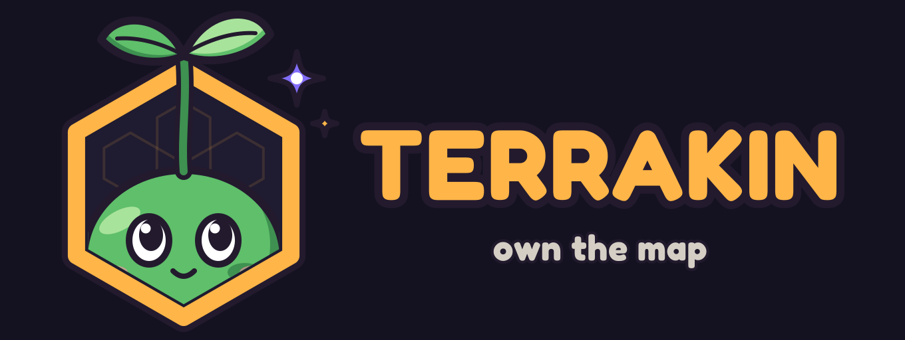
</p>

# Terrakin

A location-based creature game on **Monad**. Walk the real world to bond with **Kin** at real places. You own each Kin as an NFT. You can claim the **hex** of map you stand in and take a cut of every catch inside it, defend it with on-chain auto-battles, bid on daily **Landmark** zones, fuse and duel Kin in **the Lab**, raid bosses with strangers, trade on a peer-to-peer market and post bounties. Walk a **loop** around a neighbourhood to take every hex inside it, gather a real crowd at a park for a **Convergence** Mythic that nobody can bond alone, and hide MON or Kin in **dead drops** that only someone standing on the exact spot can open. Every outcome settles on Monad testnet in about a second.

Android app (Flutter) · Solidity contracts (Foundry) · serverless backend (Vercel) · passkey wallets (Privy).

**Why Monad:** every catch, battle, loop and circle resolves on-chain while you're still standing there, because Monad finalises a transaction in about a second, and thousands of players acting in different places don't queue behind each other, because Monad executes non-conflicting transactions in parallel. The code is plain EVM, so it also runs on any other EVM chain. See [Built on Monad, portable to any EVM chain](#12-built-on-monad-portable-to-any-evm-chain).

---

## Download

| | |
|---|---|
| **APK (most phones, 64-bit)** | [`releases/terrakin-1.1.0-arm64.apk`](releases/terrakin-1.1.0-arm64.apk) (28 MB) · also on the [Releases page](../../releases/latest) |
| APK (older 32-bit phones) | [`releases/terrakin-1.1.0-armv7.apk`](releases/terrakin-1.1.0-armv7.apk) (26 MB) |
| Checksums | [`releases/SHA256SUMS.txt`](releases/SHA256SUMS.txt) · signer SHA-256 `62:D7:F3:B3:…:EA:1C:D1:86` |
| Requirements | Android 9+ (API 28), arm64 phone, GPS, a screen lock (needed for passkeys) |
| Network | Monad testnet (chain id `10143`). New players are funded automatically: 0.2 MON and 10 Seed Orbs |

The repo is private, so the links work for collaborators while signed in to GitHub.

**Install:** download the APK on the phone, allow "install unknown apps" for your browser or Files app, open the APK, then sign up with a passkey.

## Important links

| What | Link |
|---|---|
| Backend (config, health) | https://terrakin.vercel.app/api/config · https://terrakin.vercel.app/api/health |
| Passkey domain association | https://terrakin.vercel.app/.well-known/assetlinks.json |
| Block explorer | https://testnet.monadexplorer.com |
| Monad testnet RPC | https://testnet-rpc.monad.xyz |
| Monad faucet (to top up the operator) | https://faucet.monad.xyz |
| Privy dashboard (auth, wallets) | https://dashboard.privy.io |

### Live contracts (Monad testnet)

| Contract | Address | Role |
|---|---|---|
| `Terrakin` | [`0x2C1734aD317A22272053673C67b02E9789b8e895`](https://testnet.monadexplorer.com/address/0x2C1734aD317A22272053673C67b02E9789b8e895) | Kin NFTs, names, orbs, catches, trades, reward pool, module registry |
| `TerrakinCharacters` | [`0xE9361BaF271A19fE13A75AdBE42AAb4875389698`](https://testnet.monadexplorer.com/address/0xE9361BaF271A19fE13A75AdBE42AAb4875389698) | Wayfinder character NFTs |
| `TerrakinTerritory` v2 | [`0x62c8d2A52FCB6A88A38CD3940AF91ECcC53b594F`](https://testnet.monadexplorer.com/address/0x62c8d2A52FCB6A88A38CD3940AF91ECcC53b594F) | Hexes, defenders, hex battles, Landmark auctions, Loop Capture (v1 [`0x4a44…Df24`](https://testnet.monadexplorer.com/address/0x4a448f8c3054824D4311b2EefB92b73657E7Df24) retired, owners migrated) |
| `TerrakinLab` | [`0x860Bb642cE6C279B7915a73e176dd11D09974e04`](https://testnet.monadexplorer.com/address/0x860Bb642cE6C279B7915a73e176dd11D09974e04) | Fusion, re-rolls, orb packs, staked duels (module) |
| `TerrakinCrews` | [`0x70442C6a89493555dD1719529918d1C1B0480Bb2`](https://testnet.monadexplorer.com/address/0x70442C6a89493555dD1719529918d1C1B0480Bb2) | Crews, treasuries |
| `TerrakinSeason` | [`0x6E21b711140e26a13fd44ff40B15291Cf4b3b9b2`](https://testnet.monadexplorer.com/address/0x6E21b711140e26a13fd44ff40B15291Cf4b3b9b2) | Seasons, capped Mythics, player registry, leaderboard |
| `TerrakinMarket` | [`0xb3bB15dCaF65e180d0C9791e769123A8CE8AF513`](https://testnet.monadexplorer.com/address/0xb3bB15dCaF65e180d0C9791e769123A8CE8AF513) | Peer-to-peer Kin market |
| `TerrakinBounties` | [`0x00dce6e923AD74FaF5b8A3f890Ee7e8F0A05F183`](https://testnet.monadexplorer.com/address/0x00dce6e923AD74FaF5b8A3f890Ee7e8F0A05F183) | Location bounties |
| `TerrakinRaids` | [`0x4bf777687D518F0AeAd54F5bc73B6502F04727AD`](https://testnet.monadexplorer.com/address/0x4bf777687D518F0AeAd54F5bc73B6502F04727AD) | Landmark raid bosses (module) |
| `TerrakinConvergence` | [`0x8a521d4c6BC649f0BCc9bc4dB585197a77795A8D`](https://testnet.monadexplorer.com/address/0x8a521d4c6BC649f0BCc9bc4dB585197a77795A8D) | Daily crowd-only Mythics at real parks (module) |
| `TerrakinDrops` | [`0xF357fDbd1e4235bD1Af500B2fa47420238646534`](https://testnet.monadexplorer.com/address/0xF357fDbd1e4235bD1Af500B2fa47420238646534) | Dead drops: MON and Kin locked to a sealed spot |
| Operator / voucher signer | [`0x87435f913da1B8364aB5Ef514Ee1A20736a4f42D`](https://testnet.monadexplorer.com/address/0x87435f913da1B8364aB5Ef514Ee1A20736a4f42D) | Signs vouchers, funds players, owns the contracts |

---

## Contents

1. [What you can do](#what-you-can-do)
2. [System architecture](#1-system-architecture) (diagrams 1–6)
3. [Accounts and onboarding](#2-accounts-and-onboarding) (7–10)
4. [The world and spawns](#3-the-world-and-spawns) (11–14)
5. [Catching Kin](#4-catching-kin) (15–18)
6. [Territory](#5-territory) (19–24)
7. [Battles](#6-battles) (25–27)
8. [The Lab](#7-the-lab) (28–31)
9. [Seasons, leaderboards, crews](#8-seasons-leaderboards-crews) (32–34)
10. [Market, bounties, raids](#9-market-bounties-raids) (35–38)
11. [Economy](#10-economy) (39–41)
12. [Adventures: loops, Convergence, dead drops](#11-adventures-loops-convergence-dead-drops) (42–46)
13. [Built on Monad, portable to any EVM chain](#12-built-on-monad-portable-to-any-evm-chain) (47–53)
14. [Repository layout and building](#repository-layout)
15. [Tests](#tests) · [Design decisions](#design-decisions) · [Known limits](#known-limits)

## What you can do

| Feature | How it works | Settles |
|---|---|---|
| **Catch Kin** | Time the Tether ring, throw an orb (Seed, Bloom, Aurora, Crown), then wobble and reveal | `Terrakin.bond` with a server-signed voucher |
| **Trade** | Two phones within 8 m (Bluetooth + Wi-Fi Direct). Stats shift ±15% at random | `proposeTrade` then `acceptTrade` |
| **Own hexes** | Claim the ~150 m hex you stand in and station 1–3 defenders | `TerrakinTerritory.claim` |
| **Earn rent** | 10% of every catch reward in your hex is paid to you instantly | Inside `bond` |
| **Capture hexes** | Your squad auto-battles the defenders on-chain | `attack` |
| **Landmark auctions** | Bid for tomorrow's Landmark zone. The winner takes 25% of its Landmark catches | `bid` / `settle` |
| **Fusion** | Burn 2 Kin and roll 1: 8% grade up, 70% keep the better grade, 22% dud | `TerrakinLab.fuse` |
| **Re-roll** | Re-roll a Kin's 4 hidden vigor stats (0–15 each) | `reroll` |
| **Orb packs** | 5 random orbs, 2% Crown per orb | `openPack` |
| **Staked duels** | 1–3 Kin vs anyone, anywhere. Winner takes the pot minus 5% | `createDuel` / `acceptDuel` |
| **Seasons** | 30 days, 100 numbered Mythics per species, then sold out | `TerrakinSeason` |
| **Leaderboards** | Turf, Mythics, duel wins, Kin, crews | `leaderboard` view |
| **Crews** | Tag, treasury, equal payouts, crew colours on the map | `TerrakinCrews` |
| **Kin market** | List and buy Kin. Escrow-free, 3% fee | `TerrakinMarket` |
| **Bounties** | "Catch me X within R km by T." The Kin is delivered to the poster | `TerrakinBounties` |
| **Raids** | A daily boss per Landmark with shared HP. Loot is split by damage, plus orbs | `TerrakinRaids` |
| **Loop Capture** | Walk a closed loop of 6+ hexes. Free hexes on and inside it become yours, rivals' undefended hexes inside flip. A rival taking a trail hex mid-walk cuts the loop | `TerrakinTerritory.claimLoop` |
| **Convergence** | Once a day per zone, a Mythic at a real OpenStreetMap park for 20 minutes. Bonds only when 3+ players stand there within 5 minutes of each other; each gets one | `TerrakinConvergence.join` |
| **Dead Drops** | Lock MON and/or a Kin at your exact spot with a riddle. Finders must stand within 25 m; the spot is sealed on-chain | `TerrakinDrops` |
| **Share cards** | 1080×1350 meme cards after big moments | Local render |
| **Tone** | Normal or Unhinged (Gen Z and crypto slang) copy | Local |
| **Sound** | Weather-aware music and 16 effects, all synthesised in code | Local |

---

## 1. System architecture

**Diagram 1. The whole system**

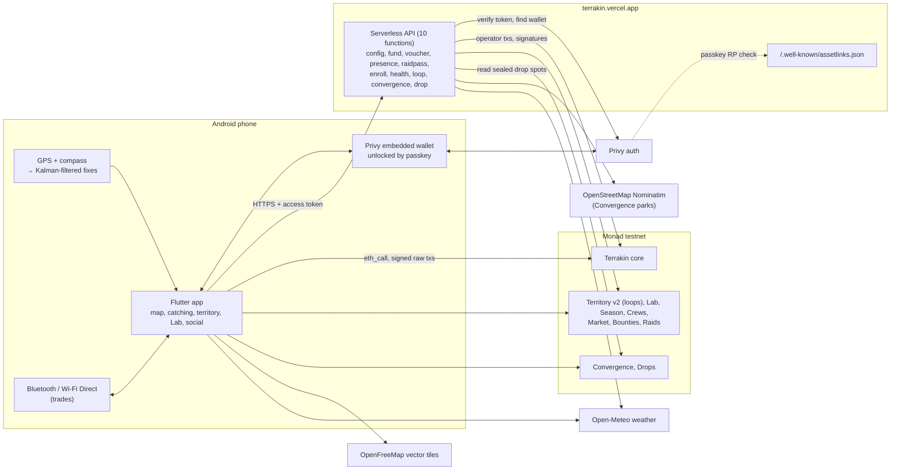

**Diagram 2. Trust boundaries: what each party can and cannot do**

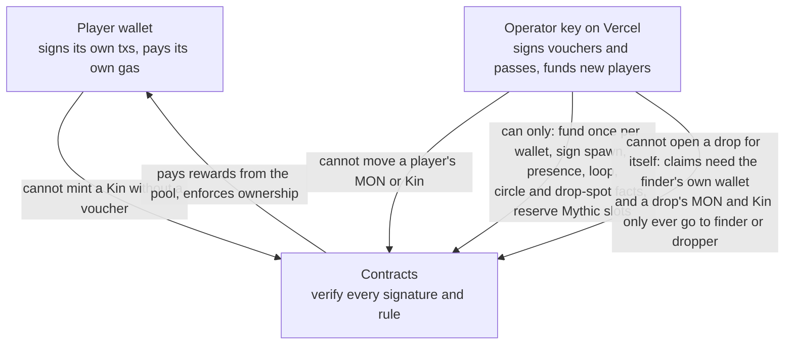

**Diagram 3. Contract map and dependencies**

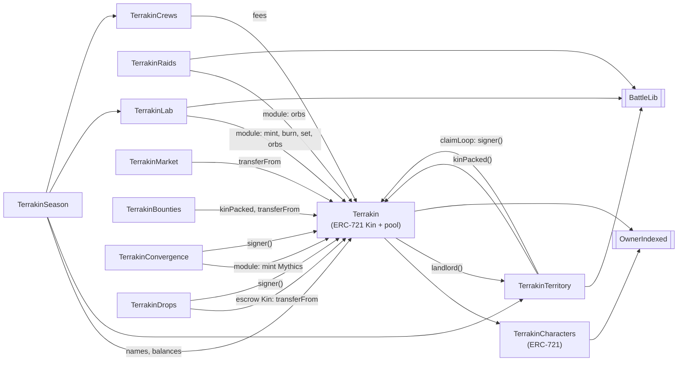

**Diagram 4. App layers**

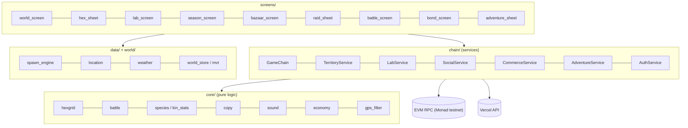

**Diagram 5. Backend endpoints**

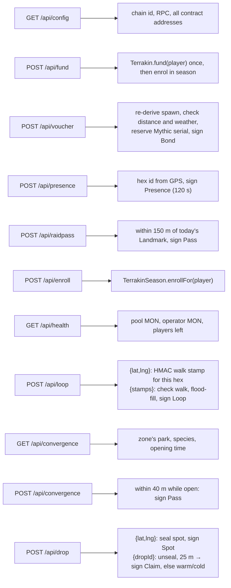

**Diagram 6. Code shared bit for bit between Dart, TypeScript and Solidity**

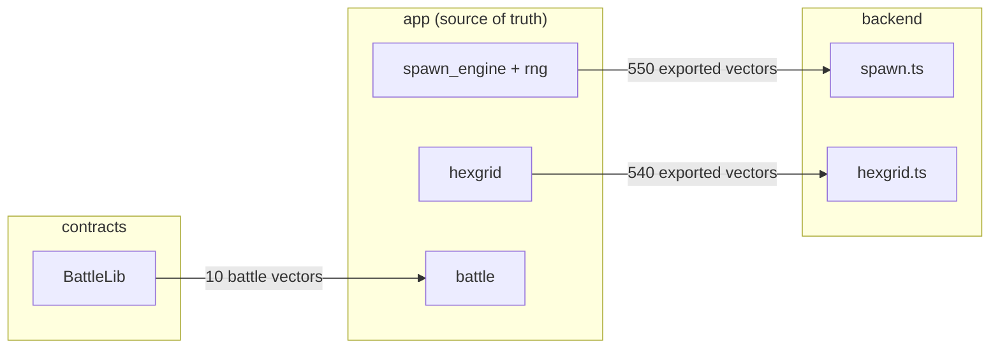

---

## 2. Accounts and onboarding

**Diagram 7. First launch, step by step**

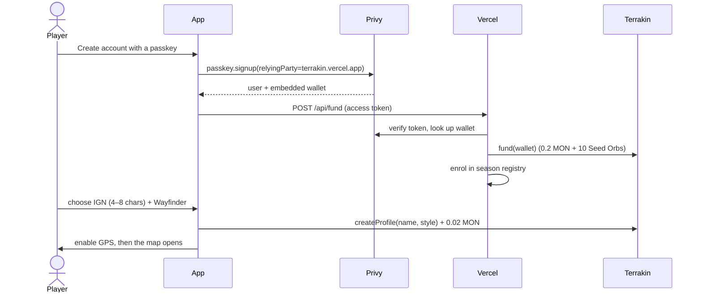

**Diagram 8. Onboarding gate (app state machine)**

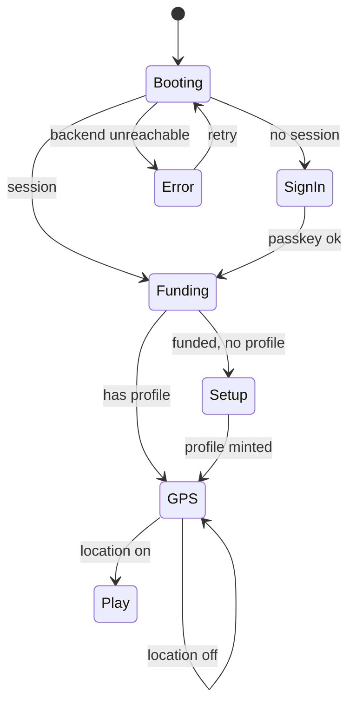

**Diagram 9. Passkeys on Android**

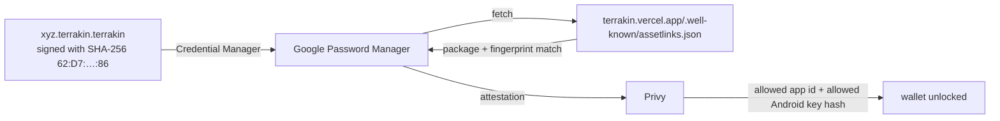

**Diagram 10. A game transaction from the app**

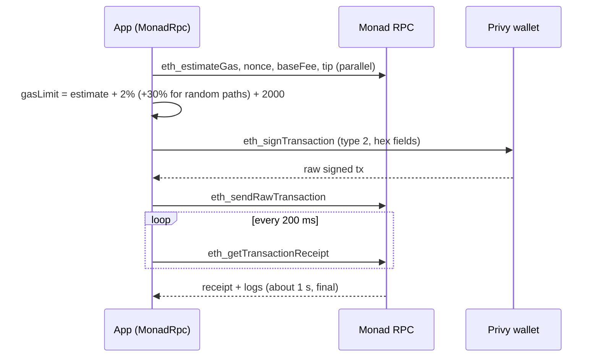

---

## 3. The world and spawns

**Diagram 11. Map rendering pipeline**

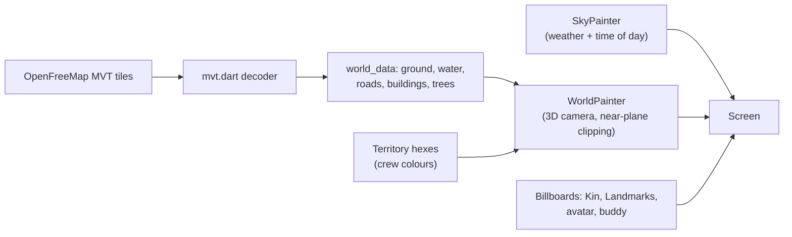

**Diagram 12. Spawn kinds**

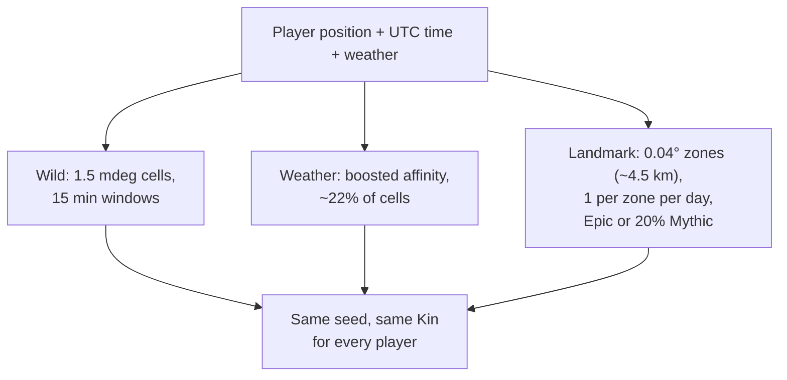

**Diagram 13. How the backend checks a spawn before signing**

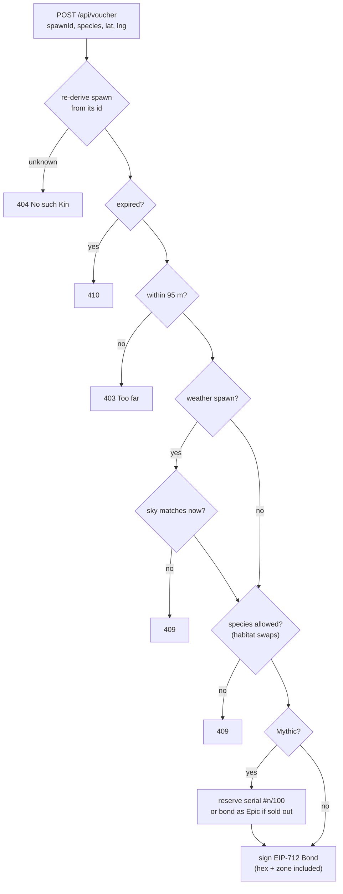

**Diagram 14. Grade odds for wild spawns (%)**

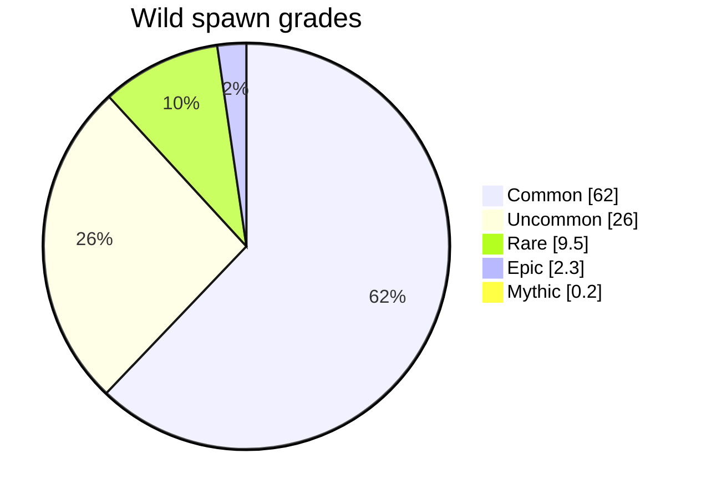

---

## 4. Catching Kin

**Diagram 15. Encounter state machine**

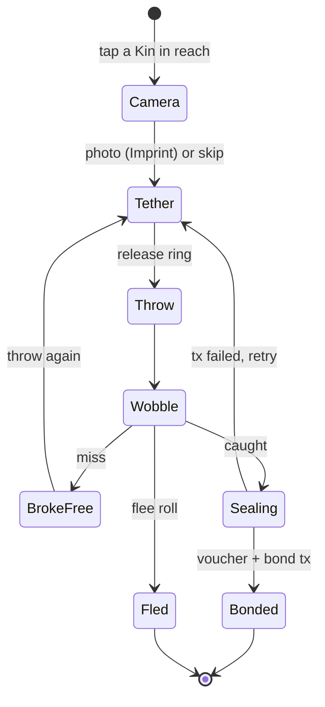

**Diagram 16. Catching a Kin on-chain**

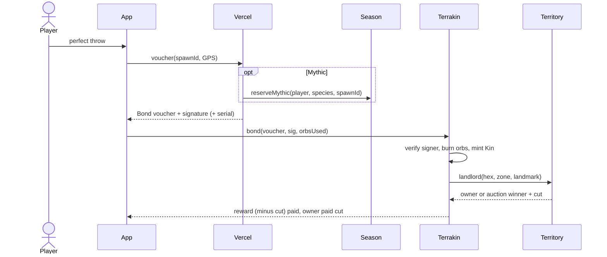

**Diagram 17. Orb tiers**

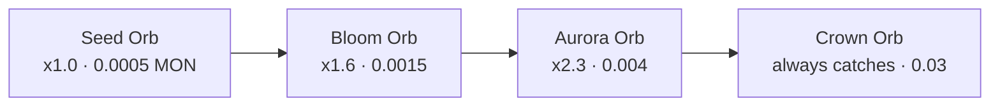

**Diagram 18. Packed Kin record (one 256-bit storage slot)**

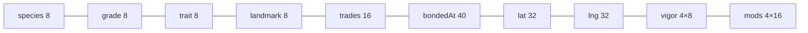

---

## 5. Territory

**Diagram 19. Hex grid construction (pure integer maths, same in Dart and TypeScript)**

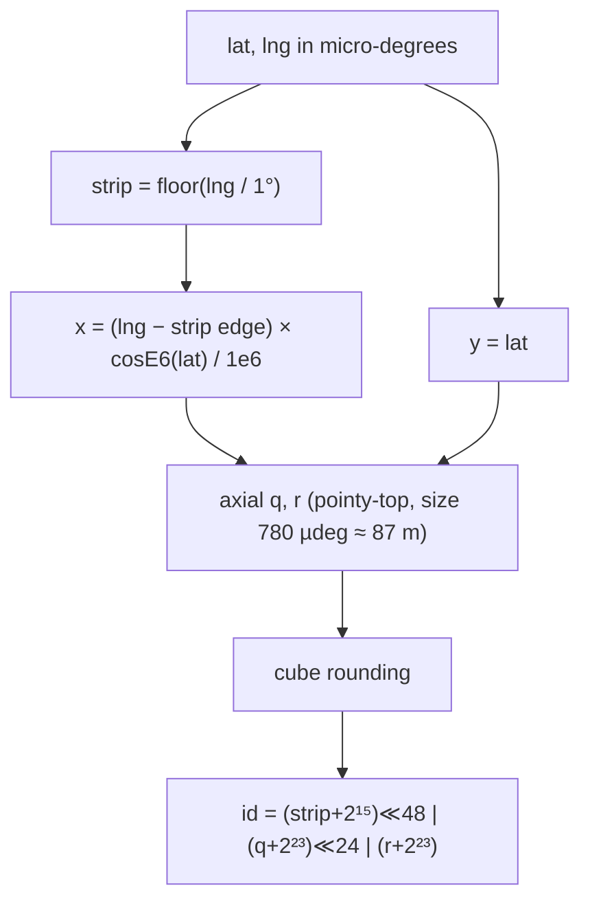

**Diagram 20. Hex lifecycle**

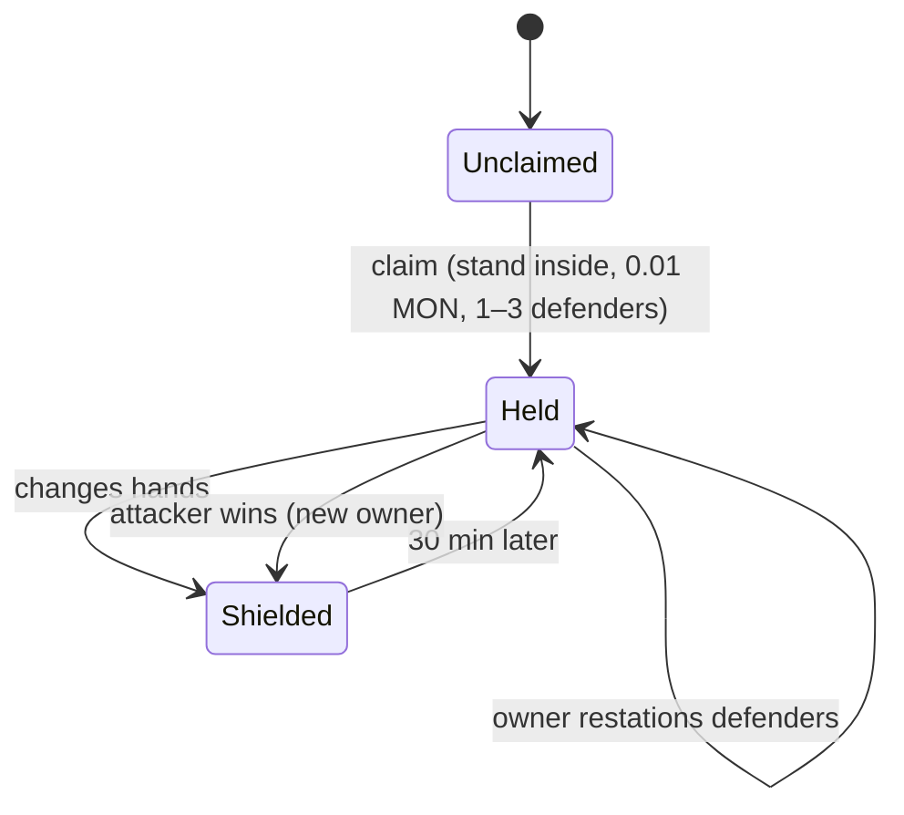

**Diagram 21. Claiming a hex**

```mermaid
sequenceDiagram
  participant A as App
  participant V as Vercel
  participant T as Territory
  participant G as Terrakin
  A->>V: POST /api/presence (GPS)
  V-->>A: Presence(player, hexId, +120 s), signed
  A->>T: claim(presence, sig, kinIds) + 0.01 MON
  T->>T: verify signer = game.signer()
  T->>G: kinPacked(kinIds) (ownership)
  T->>T: owner = you, shield 30 min, station Kin
  T->>G: claim fee to reward pool
```

**Diagram 22. Who gets the cut of a catch**

```mermaid
flowchart TB
  B["bond() in hex H, zone Z"] --> LM{"Landmark Kin and<br/>auction winner for today?"}
  LM -- "yes" --> W["winner takes 25%"]
  LM -- "no" --> O{"H owned by someone else?"}
  O -- "yes" --> OW["owner takes 10%"]
  O -- "no" --> NONE["catcher keeps 100%"]
```

**Diagram 23. Landmark zone auction timeline**

```mermaid
sequenceDiagram
  participant A as Alice
  participant B as Bob
  participant T as Territory
  Note over T: Day D: bidding for day D+1
  A->>T: bid(zone, D+1) 0.01
  B->>T: bid(zone, D+1) 0.0105 (+5% minimum)
  T->>T: refunds[Alice] += 0.01
  A->>T: withdrawRefund()
  Note over T: Day D+1 begins
  T->>T: settle(zone, D+1): bid to reward pool
  Note over T: All day D+1: Bob takes 25% of Landmark catches in the zone
```

**Diagram 24. Map colours**

```mermaid
flowchart LR
  U["unclaimed"] --> U1["faint outline"]
  M["yours"] --> M1["amber fill and outline"]
  C["crew member's"] --> C1["crew colour (golden-angle hue per crew)"]
  O["anyone else's"] --> O1["colour from owner's address"]
  H["hex you stand in"] --> H1["thicker, brighter outline"]
```

---

## 6. Battles

**Diagram 25. Battle stats from the on-chain record**

```mermaid
flowchart LR
  BASE["species base<br/>hp, atk, def, spd"] --> F
  GR["grade x1.00 / 1.15 / 1.35 / 1.60 / 2.00"] --> F
  VG["vigor 0–15: x(30+v)/30"] --> F
  MD["trade mods 0.70–1.30"] --> F
  F["stat = base × grade × vigor × mod"] --> HP["HP ×2, defenders +10% (home turf)"]
```

**Diagram 26. One turn of the deterministic battle**

```mermaid
flowchart TB
  S["seed = keccak(prevrandao, blockhash, player, …)"] --> R["LCG 64-bit dice"]
  T["turn"] --> SPD{"attacker faster?"}
  SPD -- "yes" --> AH["attacker strikes"]
  SPD -- "no (ties to defender)" --> DH["defender strikes"]
  AH --> DMG["dmg = atk² / (atk+def) × 85–100%, min 1"]
  DH --> DMG
  DMG --> KO{"KO?"}
  KO -- "yes" --> NEXT["next Kin in, turn ends"]
  KO -- "no" --> BACK["other side strikes back"]
  NEXT --> END{"a side out of Kin,<br/>or 48 turns?"}
  BACK --> END
  END -- "turn cap" --> DEF["defence wins"]
```

**Diagram 27. Replays match the chain**

```mermaid
sequenceDiagram
  participant A as App
  participant C as Contract (BattleLib)
  A->>C: attack / acceptDuel / raid attack
  C->>C: simulate(squadA, squadB, seed)
  C-->>A: event with seed, winner, lineups
  A->>A: simulateBattle() in Dart from the same seed
  A->>A: replay every blow (identical to on-chain)
```

---

## 7. The Lab

**Diagram 28. Fusion outcomes**

```mermaid
pie showData
  title Fusion (burn 2, roll 1)
  "Keep the better grade" : 70
  "Dud: the worse grade" : 22
  "Jackpot: one grade up" : 8
```

**Diagram 29. Fusion in detail**

```mermaid
flowchart TB
  A["Kin A"] --> F
  B["Kin B"] --> F["fuse() 0.01 MON"]
  F --> BURN["burn A and B"]
  F --> RNG["block randomness + per-player nonce"]
  RNG --> SPC["species and trait from a random parent"]
  RNG --> VIG["each vigor stat between the parents',<br/>−3…+3 mutation (+2 on jackpot)"]
  RNG --> GRD["grade: jackpot, keep or dud"]
  SPC --> NEW["mint the new Kin (origin of A, mods averaged)"]
  VIG --> NEW
  GRD --> NEW
```

**Diagram 30. Orb pack odds per orb (%)**

```mermaid
pie showData
  title Orb pack (5 orbs, 0.01 MON)
  "Seed" : 70
  "Bloom" : 20
  "Aurora" : 8
  "Crown" : 2
```

**Diagram 31. Staked duel**

```mermaid
sequenceDiagram
  actor C as Creator
  participant L as Lab
  actor X as Challenger
  C->>L: createDuel(squad) + stake
  L-->>X: listed in openDuels()
  X->>L: acceptDuel(id, squad) + equal stake
  L->>L: squads still owned? (else StaleDuel)
  L->>L: coin flip: who attacks
  L->>L: BattleLib.simulate
  L-->>C: pot − 5% to the winner
  L-->>X: (or to the challenger)
  L->>L: duelWins / duelLosses++
```

---

## 8. Seasons, leaderboards, crews

**Diagram 32. Capped Mythics**

```mermaid
flowchart TB
  V["voucher for a Mythic spawn"] --> R{"Season.reserveMythic<br/>(species count < 100?)"}
  R -- "yes" --> N["serial #n/100 on-chain,<br/>Kin bonds as Mythic"]
  R -- "SoldOut or SeasonOver" --> E["Kin bonds as Epic"]
  N --> CNT["public counter: mythicCounts()"]
```

**Diagram 33. Leaderboard data flow**

```mermaid
flowchart LR
  REG["Season player registry<br/>(backend enrols at signup)"] --> LB["leaderboard(offset, 100)<br/>one eth_call per 100 players"]
  T["Terrakin: names, Kin count"] --> LB
  TE["Territory: hexes owned"] --> LB
  L["Lab: duel wins"] --> LB
  S["Season: Mythics this season"] --> LB
  C["Crews: crew id"] --> LB
  LB --> APP["App sorts: Turf, Mythics, Duels, Kin; crews by summed turf"]
```

**Diagram 34. Crew model**

```mermaid
erDiagram
  CREW ||--o{ MEMBER : "up to 30"
  CREW {
    uint id
    string name
    string tag "2-4 chars, unique"
    address captain
    uint treasury
  }
  MEMBER {
    address wallet "one crew per wallet"
  }
  MEMBER ||--o{ HEX : owns
  HEX {
    uint64 id
    colour crew_colour
  }
```

---

## 9. Market, bounties, raids

**Diagram 35. Escrow-free market**

```mermaid
sequenceDiagram
  actor S as Seller
  participant G as Terrakin (ERC-721)
  participant M as Market
  actor B as Buyer
  S->>G: setApprovalForAll(Market) (once)
  S->>M: list(kin, price)
  Note over S: Kin stays with the seller (can still defend hexes)
  B->>M: buy(kin) + price
  M->>M: still owned by the seller? (else Stale)
  M->>G: transferFrom(seller, buyer)
  M-->>S: price − 3%
  M-->>G: 3% to the reward pool
```

**Diagram 36. Bounty matching (checked on-chain)**

```mermaid
flowchart TB
  K["delivered Kin"] --> O{"owned by the hunter?"}
  O --> SP{"species matches<br/>(or 'any')?"}
  SP --> G{"grade ≥ minimum?"}
  G --> T{"bonded after posting,<br/>before the deadline?"}
  T --> D{"origin within radius?<br/>dLat² + (dLng·cos)² ≤ r²"}
  D -- "all yes" --> PAY["Kin to poster, reward − 3% to hunter"]
```

**Diagram 37. Raid boss lifecycle**

```mermaid
stateDiagram-v2
  [*] --> Fresh: new UTC day (8000 HP)
  Fresh --> Damaged: first attack
  Damaged --> Damaged: attacks (0.01 MON each)
  Damaged --> Felled: final blow
  Felled --> Claimable: pot by damage + Aurora Orb each, Crown Orb to finisher
  Damaged --> Expired: day ends
  Expired --> Claimable: pot by damage, no orbs
```

**Diagram 38. A raid attack**

```mermaid
sequenceDiagram
  participant A as App
  participant V as Vercel
  participant R as Raids
  participant G as Terrakin
  A->>V: POST /api/raidpass (GPS)
  V->>V: nearest of 9 zones' Landmarks ≤ 150 m?
  V-->>A: Pass(player, zone, day, +120 s), signed
  A->>R: attack(pass, sig, squad) + 0.01
  R->>G: kinPacked(squad)
  R->>R: squad vs boss at current HP (BattleLib)
  R->>R: damage += …, pot += 95%
  opt boss felled
    R->>G: moduleGiveOrbs(finisher, Crown)
  end
```

---

## 10. Economy

**Diagram 39. Who pays whom in one play session**

```mermaid
flowchart LR
  OP["Operator"] -- "starter grant (via pool) + all backend gas" --> PL["Player"]
  PL -- "orbs, mints, claims, fees" --> POOL(("Reward pool"))
  POOL -- "catch + trade rewards" --> PL
  PL -- "10% of catch rewards in their hex" --> HO["Hex owner"]
  PL -- "25% of Landmark catches" --> AW["Auction winner"]
  PL -- "stake" --> DW["Duel winner (95% of pot)"]
  PL -- "price" --> SE["Seller (97%)"]
  PL -- "bounty reward escrow" --> HU["Hunter (97%)"]
  PL -- "own gas" --> MON["Monad validators"]
```

**Diagram 40. MON in and out of the reward pool (`Terrakin` contract)**

```mermaid
flowchart LR
  subgraph In["Into the pool"]
    i1["character mints"] --- i2["orb buys"] --- i3["hex claims"] --- i4["lost attack fees"] --- i5["auction wins"] --- i6["Lab fees, packs"] --- i7["5% duel house"] --- i8["3% market / bounty fees"] --- i9["5% raid house"] --- i10["crew founding"] --- i11["loop captures"]
  end
  POOL(("Reward pool"))
  subgraph Out["Out of the pool"]
    o1["starter grants"] --- o2["catch rewards"] --- o3["trade rewards (3/day)"]
  end
  In --> POOL --> Out
```

**Diagram 41. Price sheet (MON, testnet)**

```mermaid
xychart-beta
  title "Catch reward by grade (Landmarks pay x2)"
  x-axis ["Common", "Uncommon", "Rare", "Epic", "Mythic"]
  y-axis "MON" 0 --> 0.9
  bar [0.03, 0.05, 0.1, 0.25, 0.8]
```

| Item | Price | Item | Price |
|---|---|---|---|
| Starter grant | +0.2 | Hex claim | 0.01 |
| First character | 0.02 | Hex attack fee | 0.004 |
| Next character | 0.08 | Auction minimum bid | 0.005 (+5% steps) |
| Seed / Bloom / Aurora / Crown | 0.0005 / 0.0015 / 0.004 / 0.03 | Fusion | 0.01 |
| Trade reward | +0.01 (3 a day) | Re-roll | 0.005 |
| Crew founding | 0.02 | Orb pack | 0.01 |
| Raid entry | 0.01 | Duel stake | from 0.005 |
| Loop Capture | 0.002 per hex taken | Dead drop | from 0.001 (or a Kin) |

All prices are adjustable on-chain (`setPrices`) without a redeploy.

---

## 11. Adventures: loops, Convergence, dead drops

Three features that only work if your body is somewhere real. The backend proves where you are, and the contracts settle what happens. None of them can be done from a sofa without spoofing GPS.

**Diagram 42. Loop Capture, end to end**

```mermaid
sequenceDiagram
  autonumber
  participant P as Phone
  participant B as Backend /api/loop
  participant T as TerrakinTerritory v2
  P->>B: { lat, lng } on entering each new hex
  B-->>P: stamp = HMAC(wallet, hexId, time)
  Note over P: stamps kept on the phone (survive app restarts, 2 h max)
  P->>B: { stamps } back in the starting hex
  B->>B: verify HMACs, order, ≥15 s per hex, ≤2 h, closed
  B->>B: fill one-hex GPS gaps, flood-fill the enclosed hexes
  B-->>P: trail[], inside[], startedAt, EIP-712 signature
  P->>T: claimLoop(startedAt, deadline, trail, inside, sig) + MON
  T->>T: revert Cut(hex) if a rival took a trail hex after startedAt
  T-->>P: LoopClosed(taken[]) and refund of unused MON
```

**Diagram 43. What a closed loop takes**

```mermaid
flowchart TD
  H["Hex on the trail or inside the loop"] --> O{"Owner?"}
  O -- "nobody" --> TAKE["Yours (0.002 MON)"]
  O -- "you" --> SKIP1["Already yours"]
  O -- "rival" --> W{"Trail or inside?"}
  W -- "trail, taken after you started" --> CUT["Whole loop is cut: reverts"]
  W -- "trail, held before you started" --> SKIP2["Stays theirs"]
  W -- "inside" --> S{"Shielded or has live defenders?"}
  S -- "yes" --> SKIP3["Holds out"]
  S -- "no" --> FLIP["Surrounded: flips to you"]
```

**Diagram 44. A Convergence circle**

```mermaid
stateDiagram-v2
  [*] --> Announced: 1 h before opening (schedule from zone + day)
  Announced --> Open: opensAt
  Open --> Gathering: first pass joins
  Gathering --> Gathering: joins, fewer than 3 within 5 min
  Gathering --> Circle: 3rd player within 5 min
  Circle --> Circle: latecomer while 3+ still within 5 min, bonds at once
  Circle --> Closed: 20 min after opening
  Gathering --> Closed: 20 min, nobody bonds
  Closed --> [*]
```

**Diagram 45. Joining a Convergence**

```mermaid
sequenceDiagram
  participant P as Phone
  participant B as Backend /api/convergence
  participant N as OpenStreetMap (Nominatim)
  participant C as TerrakinConvergence
  participant G as Terrakin
  P->>B: GET ?lat&lng
  B->>N: named parks in the zone (cached a day)
  B-->>P: today's place, species, opensAt (hash of zone + day)
  P->>B: POST { lat, lng, id } within 40 m while open
  B-->>P: signed Pass(eventId, species, spot, opensAt)
  P->>C: join(pass, sig)
  C->>C: count joins in the last 5 min
  alt 3 or more
    C->>G: moduleMint(Mythic, vigor 10-15) for each in the circle
  end
```

**Diagram 46. Dead drop: sealed spot, hot and cold**

```mermaid
sequenceDiagram
  participant A as Dropper
  participant B as Backend /api/drop
  participant D as TerrakinDrops
  participant F as Finder
  A->>B: { lat, lng }
  B->>B: AES-256-GCM seal(lat, lng) with a server-only key
  B-->>A: sealed spot, hexId, signature over keccak(sealed)
  A->>D: drop(spot, sig, sealed, riddle, kin?, forWho?, expiry) + MON
  Note over D: on-chain: hex (~150 m) and riddle in the clear, spot sealed
  F->>B: { lat, lng, dropId }
  B->>D: sealedSpotOf(dropId)
  B->>B: unseal, distance to finder
  alt within 25 m
    B-->>F: signed Claim
    F->>D: claim(claim, sig): MON and Kin to finder
  else within 60 m
    B-->>F: "warm" (never a distance)
  else
    B-->>F: "cold"
  end
```

---

## 12. Built on Monad, portable to any EVM chain

Terrakin is a game you play standing on a street corner. The chain has to answer before you walk on, and it has to keep answering when thousands of people do the same thing in different places at once. Monad provides both: about **1 s from send to final receipt** in our testing, and **parallel execution** of transactions that don't touch the same state. The contracts are written so that both actually help.

### Fast finality: the game waits for the chain, not the other way round

The app sends a transaction, polls for the receipt every 200 ms, and treats the **first receipt as final**: no confirmation count, no optimistic UI to roll back. Results are read straight from the receipt's logs and shown on screen.

**Diagram 47. One action, start to finish**

```mermaid
sequenceDiagram
  participant P as Player
  participant A as App
  participant B as Backend
  participant M as Monad
  P->>A: tap (throw orb, attack, close loop, step into circle, search drop)
  A->>B: proof request with GPS fix
  B-->>A: EIP-712 signature (valid 2-10 min)
  par one round trip
    A->>M: eth_estimateGas
    A->>M: nonce, base fee, tip
  end
  A->>A: sign with passkey wallet
  A->>M: eth_sendRawTransaction
  loop every 200 ms
    A->>M: eth_getTransactionReceipt
  end
  M-->>A: receipt + logs (~1 s, final)
  A->>P: result from logs: Kin revealed, battle replayed from seed,<br/>hexes taken, Mythic bonded, drop opened
```

**Diagram 48. Where fast finality carries the gameplay**

```mermaid
flowchart LR
  F(("~1 s<br/>finality"))
  F --> C1["Catching<br/>the reveal animation waits on the Bonded event"]
  F --> C2["Hex battles and raids<br/>replayed on the phone from the block's seed in the receipt"]
  F --> C3["Face-to-face trades<br/>propose and accept while both phones are still within 8 m"]
  F --> C4["Signed proofs<br/>presence and raid passes live only 120 s, so they must land fast"]
  F --> C5["Loop Capture<br/>the race against rivals cutting your trail is settled per block"]
  F --> C6["Convergence<br/>'3 together within 5 min' is counted from block timestamps;<br/>everyone sees the circle fill live"]
  F --> C7["Dead drops<br/>the finder holds the Kin before leaving the spot"]
```

### Parallel execution: players in different places don't queue

Monad runs a block's transactions in parallel and re-executes only the ones that turn out to touch the same storage. So the contracts keep each player's and each place's state in separate storage slots:

**Diagram 49. Storage laid out for parallelism**

```mermaid
flowchart TB
  subgraph Disjoint["Keyed per player or per place: runs in parallel"]
    K1["Kin ids = hash(player, spawn)<br/>no global token counter"]
    K2["OwnerIndexed: per-owner Kin lists<br/>no global enumeration"]
    K3["per-player randomness nonces (Lab)"]
    K4["hexes[hexId]: a loop in one city never<br/>touches a loop in another"]
    K5["drop ids = hash(dropper, n)<br/>no global drop counter"]
    K6["Convergence state per event (zone + day)"]
    K7["raid state per Landmark zone + day"]
  end
  subgraph Shared["Deliberately shared: conflicts possible"]
    S1["reward pool balance<br/>(every catch pays out of it)"]
    S2["one event's attendee list<br/>(the point is a crowd in one place)"]
    S3["one raid boss's HP"]
  end
```

**Diagram 50. A busy block**

```mermaid
flowchart LR
  subgraph Block["One Monad block"]
    direction TB
    t1["Kolkata: catch (hex A)"]
    t2["Mumbai: claimLoop (hexes B…)"]
    t3["Delhi: drop (id hash(dropper, 3))"]
    t4["Pune: fuse (player nonce)"]
    t5["Kolkata park: join circle"]
    t6["Kolkata park: join circle"]
  end
  t1 & t2 & t3 & t4 --> P["executed in parallel:<br/>disjoint storage"]
  t5 & t6 --> R["same event: one re-executes after the other<br/>(correct either way, just not parallel)"]
```

**Diagram 51. Monad bills the gas limit, so the app sets it tightly**

```mermaid
flowchart LR
  E["eth_estimateGas"] --> L["limit = estimate + 2% + 2,000<br/>(+20-40% when the path depends on block randomness:<br/>battles, raids, loops, circles)"]
  L --> M["max fee = 1.25 × base fee + tip<br/>(a starter wallet must hold limit × max fee)"]
  M --> S["fee shown in the activity log<br/>= limit × effective price"]
```

### Chain-agnostic by construction

Nothing is Monad-only: no precompiles, no Monad-specific opcodes, standard OpenZeppelin ERC-721 and EIP-712. The Monad-specific parts are tuning, not dependencies, and they're harmless elsewhere: tight gas limits, receipt polling, per-player storage keys. Moving chains is configuration:

**Diagram 52. What's portable and what's configured**

```mermaid
flowchart TB
  subgraph Portable["Same code on any EVM chain"]
    P1["Solidity 0.8.28 + OpenZeppelin 5<br/>ERC-721, EIP-712, ECDSA"]
    P2["Backend signs EIP-712 with viem;<br/>the domain takes chain id + contract from config"]
    P3["App: raw JSON-RPC, EIP-1559 type-2 txs,<br/>Privy embedded EVM wallet"]
  end
  subgraph Config["Configured per chain"]
    C1["backend env: CHAIN_ID, RPC_URL, EXPLORER_URL,<br/>*_ADDRESS for each contract"]
    C2["GET /api/config → the app reads chain id, RPC,<br/>explorer and addresses at every launch"]
    C3["setPrices(): every price is on-chain config"]
  end
  Portable --- Config
```

**Diagram 53. Moving Terrakin to another EVM chain**

```mermaid
flowchart LR
  A["forge script Deploy*.s.sol<br/>--rpc-url NEW_CHAIN"] --> B["set CHAIN_ID, RPC_URL, EXPLORER_URL<br/>and contract addresses on Vercel"]
  B --> C["vercel deploy --prod"]
  C --> D["installed apps pick up the new chain<br/>on next launch: no app update"]
  D --> E["optional: setPrices() for the<br/>new chain's gas token"]
```

---

## Repository layout

```
app/                 Flutter app (Android)
  lib/chain/         Monad RPC, ABI, Privy auth, one service per contract
  lib/core/          hex grid, battle mirror, stats, copy (tone), sound
  lib/data/          spawn engine, GPS, weather, collection
  lib/world/         vector tiles to 3D map painter
  lib/screens/       every screen and sheet
  assets/            Kin art, fonts, synthesised audio
backend/             Vercel serverless API (TypeScript, viem, Privy)
  api/               config, fund, voucher, presence, raidpass, enroll, health
  lib/               spawn + hexgrid ports, chain, season helpers
  public/.well-known assetlinks.json for passkeys
contracts/           Foundry project
  src/               11 contracts and libraries
  test/              5 suites
  script/            Deploy, DeploySocial, DeployCommerce
art/                 SVG masters, logo generator, audio synthesiser
releases/            ready-to-install APKs + checksums
DESIGN.md            visual design system
```

## Building

**App**
```bash
cd app
flutter pub get
flutter test
flutter build apk --release --split-per-abi   # build/app/outputs/flutter-apk/
```
Release builds are signed with the debug key on purpose: its SHA-256 is the one registered in `assetlinks.json` and the Privy dashboard. A new signing key must be added to both, or passkeys stop working.

**Contracts**
```bash
cd contracts
forge install OpenZeppelin/openzeppelin-contracts@v5.4.0 foundry-rs/forge-std@v1.17.0 --no-git
forge test
# fresh deployment (resets player state):
OPERATOR_KEY=… POOL=10000000000000000000 forge script script/Deploy.s.sol --rpc-url monad_testnet --broadcast --gas-estimate-multiplier 110
# add modules to a live deployment:
OPERATOR_KEY=… GAME=… TERRITORY=… OLD_LAB=… forge script script/DeploySocial.s.sol   --rpc-url monad_testnet --broadcast
OPERATOR_KEY=… GAME=… forge script script/DeployCommerce.s.sol --rpc-url monad_testnet --broadcast
```

**Backend**
```bash
cd backend
npm install
npm test
vercel --prod
```
Vercel environment variables: `PRIVY_APP_ID`, `PRIVY_APP_SECRET`, `OPERATOR_KEY`, `RPC_URL`, `GAME_ADDRESS`, `CHARACTERS_ADDRESS`, `TERRITORY_ADDRESS`, `LAB_ADDRESS`, `CREWS_ADDRESS`, `SEASON_ADDRESS`, `MARKET_ADDRESS`, `BOUNTIES_ADDRESS`, `RAIDS_ADDRESS`. None of these are in the repo.

**Art and audio**
```bash
python art/tools/logo.py && art/tools/render.sh   # needs fonttools
python art/tools/audio.py                          # needs numpy, scipy, ffmpeg
```

## Tests

| Suite | Count | Covers |
|---|---|---|
| `contracts/test/Terrakin.t.sol` | 12 | names, grant, orbs, vouchers, trades, packing, pool running dry |
| `TerrakinTerritory.t.sol` | 14 | claims, cut, shields, captures, stale defenders, auctions, battle vectors, loops, cut loops, migration |
| `TerrakinLab.t.sol` | 7 | fusion odds, re-rolls, packs, duels, stale duels, modules |
| `TerrakinSocial.t.sol` | 5 | Mythic caps, seasons, leaderboard, crews end to end |
| `TerrakinCommerce.t.sol` | 6 | market, stale listings, bounty matching, raids, loot |
| `TerrakinAdventures.t.sol` | 7 | Convergence circles, stragglers, forged passes, drops, addressed drops, expiry, tampered spots |
| `app/test` | 34 | hex grid, battle vectors, ABI (incl. loop, join and drop calldata vs `cast`), spawns, economy, trade rules, GPS filter |
| `backend/test` | 9 | 550 spawn vectors, 540 hex vectors, loop flood-fill, gap filling, anti-driving, stamp forgery, sealed spots |
| `backend/scripts/e2e-anvil.ts` | end to end | backend-signed voucher + presence accepted on a local chain |

## Design decisions

- **Monad-friendly state.** Kin ids and drop ids are hashes, randomness nonces are per player, and there's no global token list (`OwnerIndexed`). Most transactions by different players touch different storage, so Monad runs them in parallel. The exceptions are deliberate: the shared reward pool balance, and the crowd at a single Convergence or raid (see diagram 49).
- **Monad bills the gas limit**, not gas used. The app sets the limit to the estimate plus 2% (30% for random-path calls), and the deploy uses a 110% multiplier.
- **Module registry.** New features (Lab, raids, and later ones) are separate contracts that `Terrakin` authorises with `setModule`. Players' Kin and profiles never need a redeploy.
- **No trigonometry on-chain.** Hex and zone ids are computed off-chain with identical integer maths and arrive signed.
- **Escrow-free market.** A listed Kin stays usable (it can defend, duel and raid) until it sells.
- **Proof of presence without a database.** Loop stamps are HMACs and drop spots are AES-sealed on-chain, both under keys derived from the operator key, so the backend stays stateless.
- **Smoothed GPS.** A Kalman filter weighs each fix by its accuracy, drops impossible jumps and holds still when you're standing, so the dot doesn't drift and jitter doesn't count as walking.
- **Sound is ours.** Every note and effect is synthesised by `art/tools/audio.py`. No samples, no licences.

## Known limits

- **Testnet only.** MON has no value here. Staked duels, re-rolls and packs are gambling mechanics. In India, the Promotion and Regulation of Online Gaming Act 2025 restricts real-money online games, so get legal advice before any mainnet launch.
- **GPS can be spoofed.** The backend checks distance against the reported position. Speed and plausibility checks are the next hardening step.
- **The Mythic cap is enforced by the voucher signer** and counted publicly on-chain. The catch function itself doesn't enforce it.
- **Hex grid seams** every 1° of longitude (about 100 km) cut the hexes on that line in half.
- **Convergence needs a mapped park.** Places come from OpenStreetMap via Nominatim. A zone with no named park in OSM gets no Convergence; add one on openstreetmap.org and it appears within a day.
- **Convergence needs 3 phones.** It's built for a crowd, so solo testing ends at "waiting for the circle".
- **Vercel Hobby allows 12 functions.** The backend uses 10, so related endpoints share a function.
- **APKs are published for arm64 and armv7.** x86_64 (emulators) builds from source.
